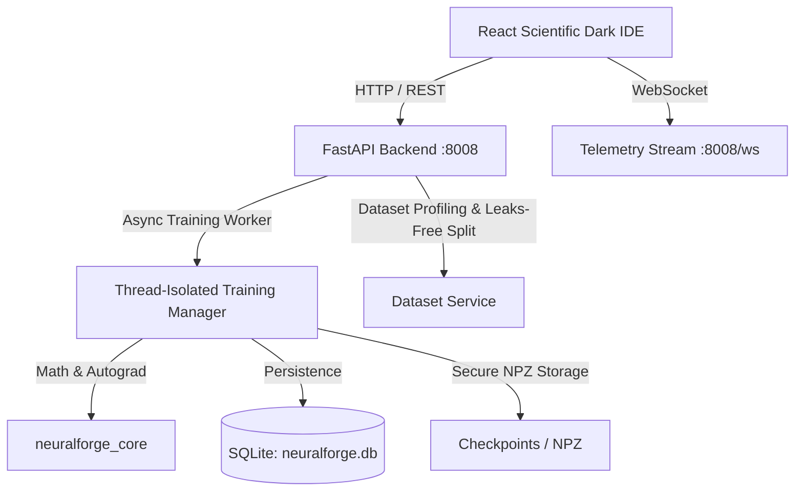

```text
  _    _ ______ __   __ _____ _______ ______ _____  ______ ____  
 | |  | |  ____|\ \ / // ____|__   __|  ____|  __ \|  ____/ __ \ 
 | |__| | |__    \ V /| (___    | |  | |__  | |__) | |__ | |  | |
 |  __  |  __|    > <  \___ \   | |  |  __| |  _  /|  __|| |  | |
 | |  | | |____  / . \ ____) |  | |  | |____| | \ \| |___| |__| |
 |_|  |_|______|/_/ \_\_____/   |_|  |______|_|  \_\______\____/ 
                  --- Crafted by hexstereo ---
```

# NeuralForge — AI Research & Neural Network Training Studio
**Author & Lead Architect:** [hexstereo](https://github.com/HexStereo)

NeuralForge is an AI research platform and neural network training studio. It pairs a **ground-up computational engine and automatic reverse-mode differentiation framework** (`neuralforge_core`) with an asynchronous **FastAPI backend** and a high-information-density **React / TypeScript scientific IDE frontend** featuring node-based visual architecture composition (React Flow), leak-free dataset ingestion and statistical profiling, live training telemetry streaming via WebSockets, layer activation and parameter distribution inspection, and side-by-side experiment comparisons.


---

## System Architecture



### 1. Six Primary Workspaces
1. **Overview**: Project summaries, system telemetry, quick actions, and recent experiment history.
2. **Network Builder**: Node-based visual architecture editor with React Flow. Supports Dense, ReLU, Sigmoid, Tanh, Softmax, Flatten, and Dropout with live dimension validation and parameter counting.
3. **Dataset Studio**: CSV ingestion, upload size enforcement (50 MB max), automated statistical profiling (missing values, min/max/mean/std), feature/target selectors, and leak-free train/val/test splitting.
4. **Training Lab**: Hyperparameter configuration (epochs, batch size, learning rate, Adam/SGD, Cross-Entropy/MSE, seed), live step/epoch progress, interactive Recharts loss/accuracy curves, and cooperative cancellation.
5. **Model Inspector**: Real intermediate layer activations captured from test inference, weight & bias distributions with 10-bin histograms, confusion matrix heatmaps, and per-class precision/recall/F1 metrics.
6. **Experiment Center**: Filterable table of past runs, side-by-side multi-run comparison overlay (loss curves & hyperparameter diffs), checkpoint manager, and JSON export.

---

## Directory Structure

```
NeuralForge/
├── backend/
│   ├── app/
│   │   ├── api/             # FastAPI routers (health, projects, datasets, architectures, training, experiments, inspector)
│   │   ├── core/            # Settings, path config
│   │   ├── models/          # SQLAlchemy ORM models (Project, Dataset, Architecture, Experiment, Checkpoint)
│   │   ├── schemas/         # Pydantic schemas for request/response validation
│   │   ├── services/        # Dataset profiling, Architecture validation/compilation, Model Inspector
│   │   ├── workers/         # Background training worker & WebSocket broadcaster
│   │   └── main.py          # App entry point, CORS, lifespan database creation
│   └── tests/
│       ├── test_api_foundation.py
│       └── test_full_workflow.py
├── frontend/
│   ├── src/
│   │   ├── components/      # Universal Header, Project Selector
│   │   ├── features/
│   │   │   ├── dashboard/   # Overview workspace
│   │   │   ├── network-builder/ # React Flow graph editor
│   │   │   ├── datasets/    # Dataset Studio workspace
│   │   │   ├── training/    # Training Lab workspace
│   │   │   ├── model-inspector/ # Model Inspector workspace
│   │   │   └── experiments/ # Experiment Center workspace
│   │   ├── services/        # Typed API client & WebSocket connector
│   │   ├── test/            # Vitest unit test suite
│   │   ├── types/           # Strict TypeScript interfaces
│   │   ├── App.tsx
│   │   └── index.css        # Scientific Dark IDE design tokens & components
│   ├── package.json
│   └── vite.config.ts
├── neuralforge_core/        # Pure Python numerical computation package
│   ├── autograd.py          # Reverse-mode autograd engine & unbroadcasting
│   ├── checkpoint.py        # Secure NPZ checkpoint saving & loading (no pickle)
│   ├── data/                # Dataset, ArrayDataset, DataLoader
│   ├── layers/              # Dense, ReLU, Sigmoid, Tanh, Softmax, Flatten, Dropout, Sequential
│   ├── losses/              # Log-sum-exp CrossEntropyLoss, MSELoss
│   ├── metrics.py           # Accuracy, MAE, MSE, RMSE, R2, Confusion Matrix, Classification Report
│   ├── module.py            # Module, Parameter, state_dict
│   ├── optimizers/          # SGD with momentum, Adam with bias correction
│   ├── tensor.py            # Tensor with operator overloading & backward()
│   └── tests/
│       ├── test_engine.py   # Finite-difference gradient checks & numerical ops
│       └── test_end_to_end_training.py
├── datasets/                # Local dataset storage & sample datasets
├── artifacts/checkpoints/   # Checkpoint storage (.npz)
├── docs/                    # Mathematical, architectural, and API documentation
├── requirements.txt         # Frozen backend dependencies
├── pytest.ini               # Pytest configuration
└── README.md
```

---

## Setup & Execution (Windows CMD)

### Prerequisites
- Python 3.12+ (64-bit)
- Node.js v18+ & npm

### Terminal 1: Backend Setup & Launch
Open a Windows Command Prompt (`cmd.exe`) in the project directory:

```cmd
cd NeuralForge

:: 1. Create and activate virtual environment
py -3.12 -m venv .venv
call .venv\Scripts\activate.bat

:: 2. Install dependencies
pip install -r requirements.txt

:: 3. Run automated backend and mathematical tests
pytest -v

:: 4. Start the FastAPI backend server
python -m uvicorn backend.app.main:app --host 127.0.0.1 --port 8008
```

Backend API documentation is available interactively at:
`http://127.0.0.1:8008/docs`

### Terminal 2: Frontend Setup & Launch
Open a second Windows Command Prompt (`cmd.exe`) in the project directory:

```cmd
cd NeuralForge\frontend

:: 1. Install frontend packages
npm install

:: 2. Run frontend unit tests (Vitest)
npm test

:: 3. Build production bundle (TypeScript & Vite)
npm run build

:: 4. Start the development server
npm run dev
```

The application will be accessible at:
`http://localhost:5173/`

---

## Core Engine Mathematical Validation

Analytical gradients in `neuralforge_core` are validated against finite-difference numerical approximations:

$$\frac{\partial f}{\partial x_i} \approx \frac{f(x + \epsilon e_i) - f(x - \epsilon e_i)}{2\epsilon}, \quad \epsilon = 10^{-6}$$

Relative error tolerance $\frac{\|\nabla_{\text{analytical}} - \nabla_{\text{numerical}}\|}{\|\nabla_{\text{analytical}}\| + \|\nabla_{\text{numerical}}\| + 10^{-12}} < 10^{-4}$ is strictly maintained across:
- Matrix multiplication: $\frac{\partial}{\partial X}(XW) = G W^T$, $\frac{\partial}{\partial W}(XW) = X^T G$
- Unbroadcasting: $\sum_{\text{axes}} G$
- Fused Log-Sum-Exp Softmax Cross-Entropy Loss: $\frac{\partial L}{\partial Z} = \frac{1}{N}(\text{softmax}(Z) - Y)$
- Activations: $\text{ReLU}$, $\text{Sigmoid}$, $\text{Tanh}$, $\text{Softmax}$

Run the full verification suite:
```cmd
pytest -v neuralforge_core/tests/test_engine.py
```
